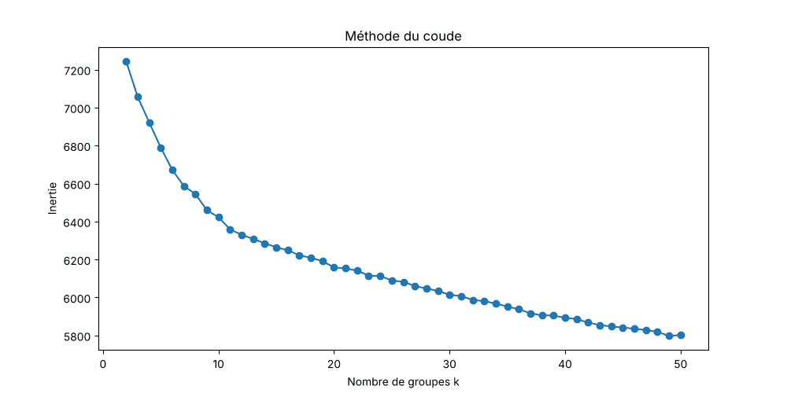

# The Lazy Librarian

Projet Kaggle : recommander à chaque lecteur les 10 livres qu'il a le plus de chances d'emprunter ensuite.

- Equipe Kaggle : UNIL_
- Score Kaggle retenu : 0.16644
- Vidéo :

## 1. Objectif

On doit prédire 10 livres par lecteur. Kaggle donne un score à chaque soumission. La baseline fait 0.15283, il faut au moins arriver à ça.

## 2. Données

- interactions.csv : les emprunts (lecteur, livre, date). Il y a 87 047 emprunts, 7 838 lecteurs et 15 109 livres.
- items.csv : les infos sur les livres (titre, auteur, sujets)
- sample_submission.csv : le format à rendre

## 3. EDA

à faire

## 4. Le schéma qu'on a suivi

On a gardé le même schéma pour toutes les tentatives, seul le modèle change :

1. On lit les emprunts et on les range par lecteur, du plus ancien au plus récent.
2. On entraîne le modèle sur les emprunts.
3. Le modèle propose 10 livres à chaque lecteur.
4. On écrit le fichier et on l'envoie sur Kaggle.

Ce schéma est dans src/lancement.py. Chaque tentative a son modèle dans le dossier src et un petit script pour la lancer.

## 5. Les tentatives

### Tentative 1 : la popularité

Pour commencer on voulait surtout vérifier que tout marchait : lire les données, sortir un fichier au bon format et avoir un score sur Kaggle. On a donc pris l'idée la plus simple possible : compter combien de fois chaque livre a été emprunté et proposer les 10 premiers à tout le monde.

Le score est très bas. C'est logique, dans une bibliothèque universitaire chacun emprunte les livres de son domaine, donc les mêmes 10 livres ne peuvent pas convenir à tout le monde.

Code : src/popularity.py et tentative_1.py

### Tentative 2 : item-to-item

Le problème de la tentative 1 c'est qu'elle ne regarde pas ce que le lecteur a déjà emprunté. On est donc partis de l'idée "ceux qui ont emprunté ce livre ont aussi emprunté...".

- On compte pour chaque paire de livres combien de lecteurs ont emprunté les deux.
- On calcule la similarité cosinus : lecteurs en commun / racine(lecteurs du livre A x lecteurs du livre B). Diviser évite que les livres très populaires soient proches de tous les autres.
- Pour un lecteur, chaque livre qu'il a emprunté donne des points aux livres proches. On propose les 10 livres qui ont le plus de points.
- S'il n'y a pas assez de livres on complète avec les plus populaires.

Le score Kaggle passe de 0.010 à 0.164, au-dessus de la baseline.

Code : src/item_to_item.py et tentative_2.py

### Tentative 3 : sans les livres déjà empruntés

Dans la tentative 2 le modèle propose souvent des livres que le lecteur a déjà empruntés. On s'est demandé si c'était vraiment utile, donc on a refait la même chose en les enlevant.

Le score Kaggle tombe à 0.025. En regardant les données on a vu qu'environ 30% des emprunts sont des réemprunts, les gens reprennent souvent le même livre. On a donc gardé les réemprunts.

Code : src/sans_reemprunts.py et tentative_3.py

### Tentative 4 : garder seulement les k livres les plus proches

Dans la tentative 2 un livre donne des points à tous les livres qui ont au moins un lecteur en commun avec lui. On a voulu voir si c'était mieux de garder seulement les k plus proches, comme pour les k plus proches voisins.

On a essayé avec 20, 50 et 100 voisins. Plus on en garde, mieux c'est, donc on n'a pas gardé de limite. Avec 100 voisins le score Kaggle est 0.163, presque pareil que la tentative 2.

Code : src/voisins.py et tentative_4.py

### Tentative 5 : user-to-user

Au lieu de chercher les livres proches on cherche les lecteurs proches. Deux lecteurs sont proches s'ils ont emprunté les mêmes livres, avec la même formule de similarité cosinus. Ensuite chaque lecteur proche donne des points aux livres qu'il a empruntés.

Le score Kaggle est 0.154, c'est moins bien que l'item-to-item.

Code : src/user_to_user.py et tentative_5.py

### Tentative 6 : mélange des deux

On s'est dit que les deux modèles pouvaient se compléter, donc on additionne leurs points. Comme les points des deux modèles ne sont pas à la même échelle, on divise d'abord par le maximum de chaque modèle pour que tout soit entre 0 et 1. Ensuite on donne un poids à chacun.

On a essayé plusieurs poids et on a gardé 0.8 pour l'item-to-item et 0.2 pour le user-to-user. Le score Kaggle est 0.166, c'est notre meilleur score de la première partie.

Code : src/melange.py et tentative_6.py

### Tentative 7 : groupes de lecteurs (clustering)

Pour la deuxième partie on passe à l'apprentissage non supervisé. L'idée est de regrouper les lecteurs qui lisent sur les mêmes sujets, puis de proposer à chacun les livres les plus empruntés de son groupe.

- Chaque lecteur est représenté par les sujets de ses livres (colonne Subjects de items.csv), transformés en TF-IDF.
- On fait les groupes avec k-means.
- Pour choisir le nombre de groupes on a utilisé la méthode du coude : on calcule l'inertie pour k de 2 à 50. La courbe se casse à k = 11, donc on a pris 11 groupes.
- Chaque lecteur reçoit les livres les plus empruntés de son groupe. S'il en manque on complète avec les plus populaires.



Les groupes ont du sens : droit suisse, histoire suisse, soins infirmiers, mangas, BD, romans, livres jeunesse, dictionnaires, guides de voyage, manuels scolaires, et un grand groupe plus mélangé.

Par contre le résultat n'est pas celui qu'on espérait. Le score Kaggle est 0.02392, très loin de la baseline. Tous les lecteurs d'un même groupe reçoivent les mêmes 10 livres, donc au final c'est presque la tentative 1 mais par groupe. En plus le modèle ne tient presque plus compte de ce que le lecteur a emprunté lui-même, alors que les réemprunts comptent beaucoup (tentative 3). Et le grand groupe mélangé contient 43% des lecteurs, eux reçoivent surtout des livres populaires.

$\color{red}{\textbf{Non retenu : non conforme aux consignes.}}$ Le clustering n'est ni du user-to-user ni de l'item-to-item, alors que les consignes n'autorisent que ces deux méthodes ou un mélange des deux.

Code : src/clustering.py, coude.py et tentative_7.py

### Tentative 8 : règles d'association

On a ensuite essayé l'autre méthode non supervisée vue en cours : les règles d'association, du type "ceux qui empruntent A empruntent aussi B".

- On fait un panier par lecteur avec les livres qu'il a empruntés, et on cherche les paires de livres souvent empruntées ensemble avec fpgrowth.
- On garde les règles avec une confiance d'au moins 0.35 et un lift plus grand que 1, comme en cours.
- Le support minimal est de 2 lecteurs. Avec 0.04 comme en cours il ne sortait aucune règle, nos données sont beaucoup plus dispersées.
- Pour un lecteur, on prend les règles qui partent d'un livre qu'il a emprunté, on enlève les livres qu'il a déjà empruntés et on garde la meilleure règle pour chaque livre, triée par confiance.

Le score Kaggle est 0.02721. Comme pour la tentative 3, enlever les livres déjà empruntés fait chuter le score, alors que les réemprunts sont nombreux.

$\color{red}{\textbf{Non retenu : non conforme aux consignes.}}$ Les règles d'association ne sont ni du user-to-user ni de l'item-to-item, et elles utilisent la librairie mlxtend. Ça ne correspond pas aux consignes.

Code : src/regles_association.py et tentative_8.py

### Tentative 9 : mélange complet

Seules, les deux méthodes non supervisées donnent de mauvais scores, mais elles apportent des infos que les autres modèles n'ont pas : le domaine du lecteur pour le clustering, et les livres souvent empruntés ensemble pour les règles. On a donc fait comme pour la tentative 6 et on a mélangé les quatre modèles.

- Les points de chaque modèle sont divisés par leur maximum pour être entre 0 et 1.
- Poids : 0.64 pour l'item-to-item, 0.16 pour le user-to-user (les poids de la tentative 6 réduits), 0.1 pour les règles d'association et 0.1 pour le clustering.

Le score Kaggle est 0.16768, un peu mieux que la tentative 6.

$\color{red}{\textbf{Non retenu : non conforme aux consignes.}}$ Ce mélange contient le clustering et les règles d'association (avec mlxtend), qui ne correspondent pas aux consignes : seulement du user-to-user, de l'item-to-item ou un mélange des deux. C'est seulement un test, même si le score est plus élevé on ne le retient pas.

Code : src/melange_complet.py et tentative_9.py

### Tentative 10 : item-to-item avec le contenu des livres

Jusqu'ici l'item-to-item comparait les livres par leurs lecteurs. Ici on les compare par ce qu'ils contiennent, avec les infos de items.csv.

- Pour chaque livre on fait un texte avec le titre, l'auteur et les sujets, qu'on transforme en TF-IDF.
- On calcule la similarité cosinus entre les livres.
- Pour un lecteur, chaque livre qu'il a emprunté donne des points aux livres qui lui ressemblent. On garde les 300 meilleurs candidats, puis les 10 premiers.
- Un livre se ressemble à lui-même, donc les réemprunts restent proposés.

L'avantage c'est que ça marche aussi pour les livres peu empruntés, et que ça trouve les suites d'une série ou les autres livres d'un même auteur. Par contre le modèle ne sait pas ce que les gens empruntent vraiment ensemble.

Le score Kaggle est 0.14480. C'est un peu sous la baseline, mais pas très loin, alors que le modèle ne regarde jamais les autres lecteurs.

Code : src/contenu.py et tentative_10.py

### Tentative 11 : mélange complet avec le contenu

Le contenu apporte une info que les quatre autres modèles n'ont pas, donc on l'a ajouté au mélange de la tentative 9. On garde les proportions de la tentative 9 multipliées par 0.8 et on donne 0.2 au contenu : 0.512 pour l'item-to-item, 0.128 pour le user-to-user, 0.08 pour les règles d'association, 0.08 pour le clustering et 0.2 pour le contenu.

Le score Kaggle est 0.16828, c'est le plus haut qu'on ait eu.

$\color{red}{\textbf{Non retenu : non conforme aux consignes.}}$ Comme la tentative 9, ce mélange contient le clustering et les règles d'association (avec mlxtend), qui ne correspondent pas aux consignes. C'est seulement un test, même si le score est plus élevé on ne le retient pas.

Code : src/melange_contenu.py et tentative_11.py

## 6. Progression

| Date | Tentative | Score Kaggle |
|------|-----------|--------------|
| 18/11 | 1. Popularité | 0.01044 |
| 21/11 | 2. Item-to-item | 0.16373 |
| 21/11 | 3. Sans les livres déjà empruntés | 0.02541 |
| 21/11 | 4. Item-to-item avec 100 voisins | 0.16349 |
| 21/11 | 5. User-to-user | 0.15366 |
| 21/11 | 6. Mélange 0.8 / 0.2 | 0.16644 |
| 24/11 | 7. Clustering (11 groupes), $\color{red}{\textbf{non retenu}}$ | 0.02392 |
| 25/11 | 8. Règles d'association, $\color{red}{\textbf{non retenu}}$ | 0.02721 |
| 25/11 | 9. Mélange complet, $\color{red}{\textbf{non retenu}}$ | 0.16768 |
| 25/11 | 10. Contenu (titre, auteur, sujets) | 0.14480 |
| 25/11 | 11. Mélange complet + contenu, $\color{red}{\textbf{non retenu}}$ | 0.16828 |
| | Baseline | 0.15283 |

## 7. Gain par rapport à la baseline

Notre meilleur score Kaggle retenu est 0.16644 avec la tentative 6, contre 0.15283 pour la baseline. Ça fait 0.01361 de plus, soit environ 9%. Les tentatives 9 et 11 ont un score plus élevé, mais elles ne sont pas retenues car elles ne correspondent pas aux consignes (voir plus haut).

## 8. Exemples de recommandations

à faire

## 9. Outils

| Outil | Utilisation |
|-------|-------------|
| Python | boucles et dictionnaires pour les modèles |
| VS Code | écrire et lancer le code |
| pandas | lecture des données et écriture des soumissions |
| numpy | tri des livres les plus proches |
| scikit-learn | TF-IDF et similarité cosinus (k-means seulement pour un test non retenu) |
| matplotlib | graphique du coude (test non retenu) |
| mlxtend | règles d'association (test non retenu) |
| Streamlit | application |
| GitHub | partage du code |
| Kaggle | données et soumissions |

## 10. Collaborations et sources

à faire

## 11. Lancer le projet

```
pip install -r requirements.txt
```

Mettre les 3 fichiers de Kaggle dans le dossier data puis lancer la tentative voulue, par exemple :

```
python tentative_2.py
```

Le fichier pour Kaggle est écrit dans le dossier submissions. Les tentatives 8, 9 et 11 sont plus longues (7 à 10 minutes) à cause de fpgrowth.

Pour refaire le graphique du coude :

```
python coude.py
```

Pour l'application :

```
streamlit run app.py
```

## Conclusion

à faire
